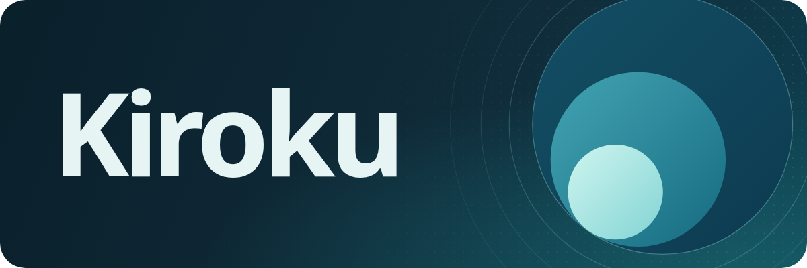

  

Your MyAnimeList anime list on Android.

  <a href="https://github.com/kauri-off/kiroku/releases/latest/download/kiroku.apk"><strong>Download APK</strong></a>
  · <a href="https://github.com/kauri-off/kiroku/releases/latest">Latest release</a>
  · <a href="README.ru.md">По-русски</a>

## What you can do

- **Track what you watch.** Mark an episode watched in one tap and update your statuses and scores in MyAnimeList.
- **Keep up with airing anime.** See how many episodes have aired and how many you have left to watch. Get notified
  when a new episode of a show you're watching airs.
- **Find your next anime.** Search by title, browse this season's anime and rankings, and explore related anime and
  recommendations.
- **Explore profiles.** View your watching statistics and open other users' public lists.

The app is available in English and Russian.

## Get started

1. Download and open `kiroku.apk` on Android 8.0 or later. If Android asks, allow app installation from the app you used
   to open the APK.
2. Open Kiroku and sign in to MyAnimeList to sync your list. You can also browse anime without signing in.
3. Allow notifications if you'd like alerts for new episodes. You can adjust the timing in Kiroku's notification settings.

You can get updates through [GitHub Releases](https://github.com/kauri-off/kiroku/releases) or add the repository to
Obtainium.

[Privacy](PRIVACY.md) · [Report an issue](https://github.com/kauri-off/kiroku/issues) ·
[Contributing](CONTRIBUTING.md) · [GPL-3.0-or-later](LICENSE)

Kiroku is an unofficial client. It is not affiliated with or endorsed by MyAnimeList or AniList.
